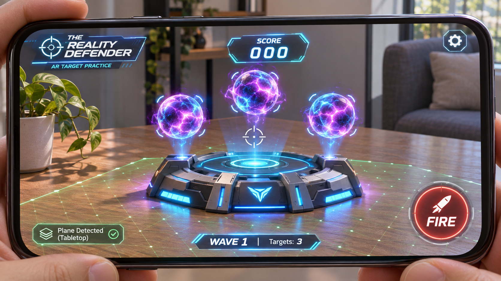
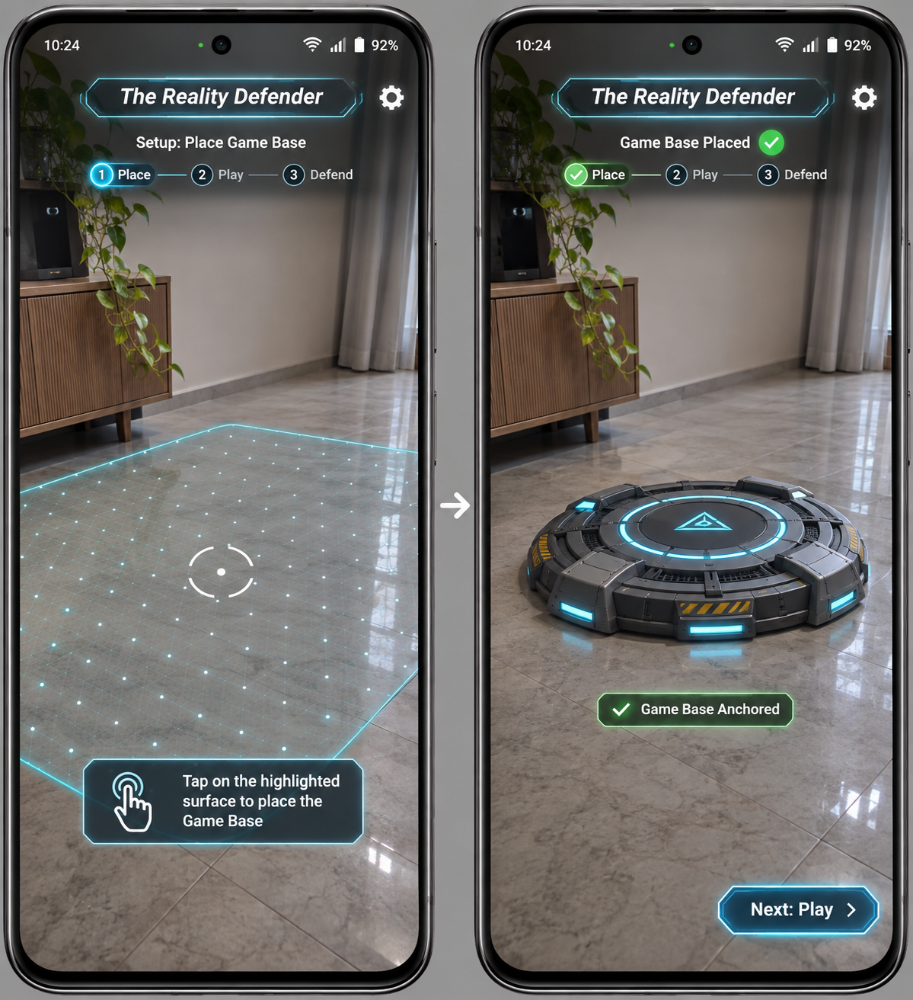
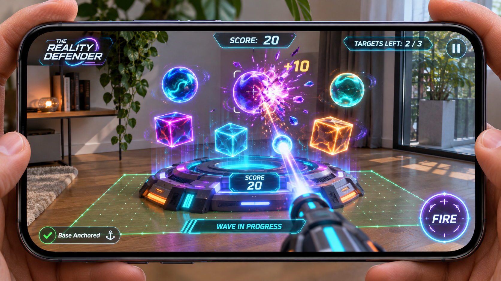
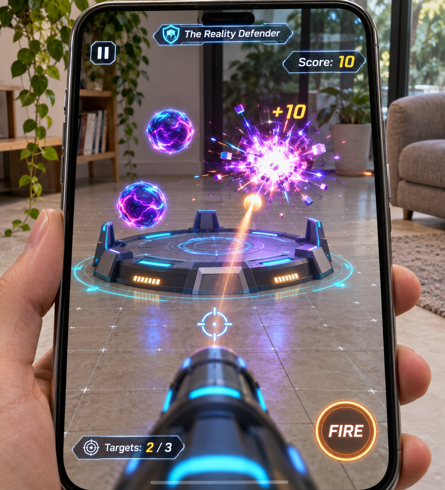
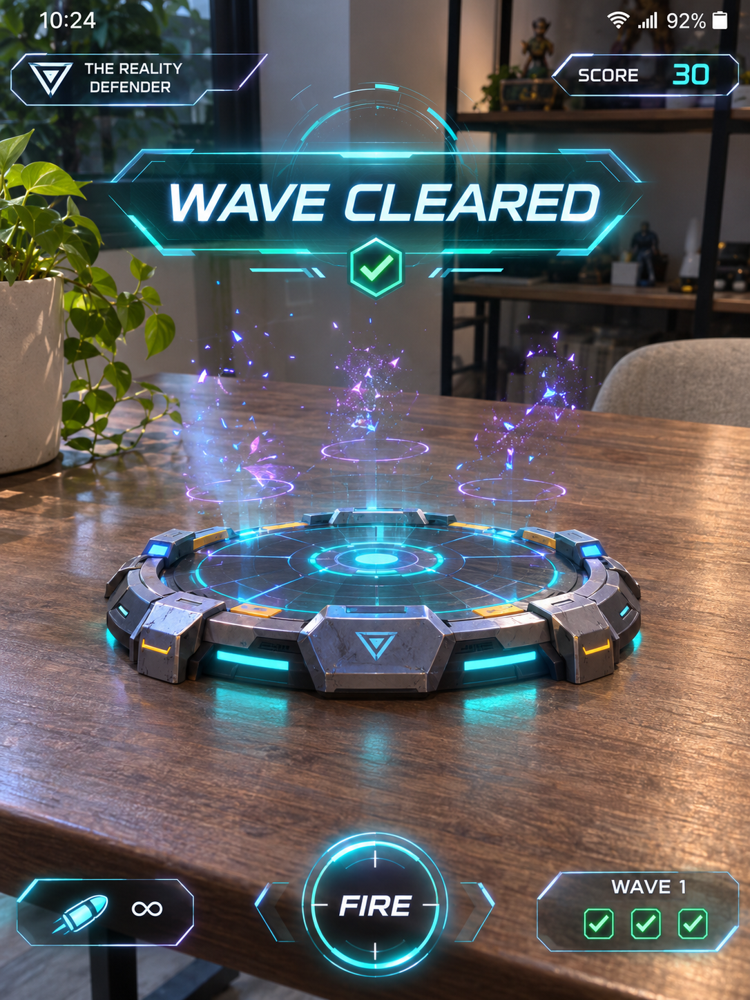
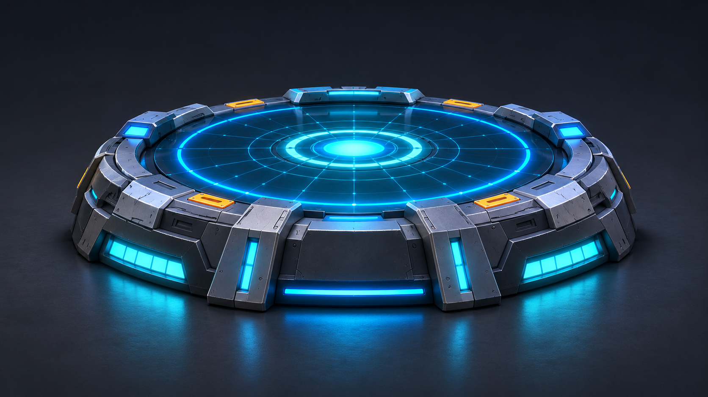
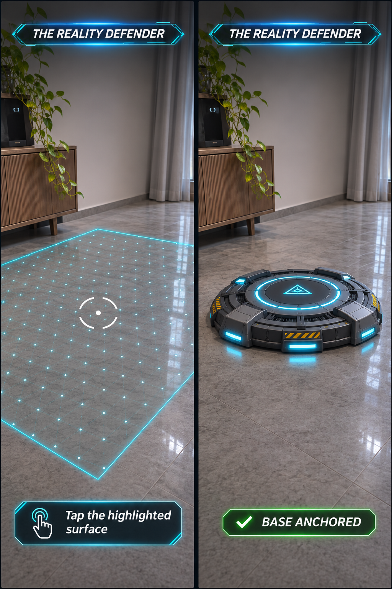
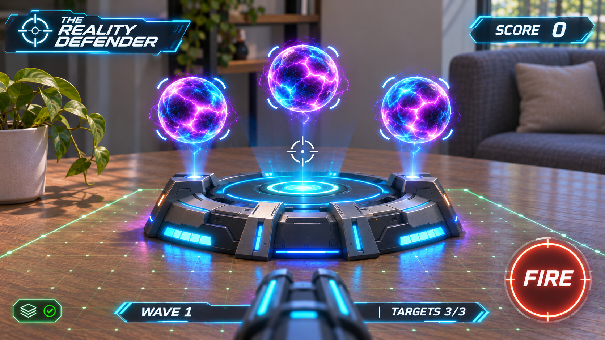
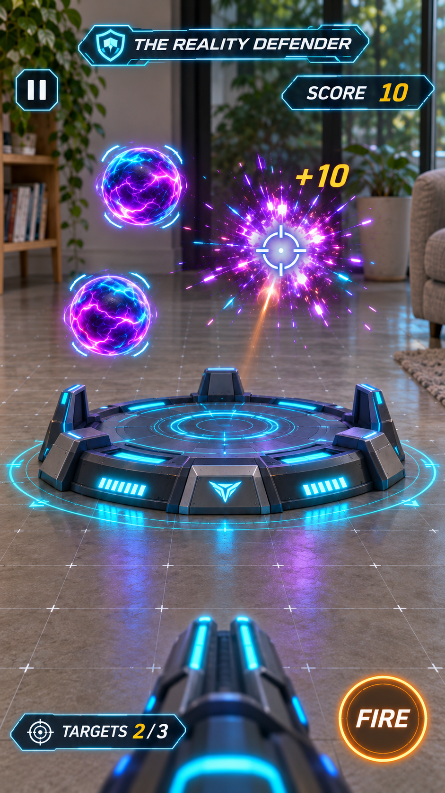
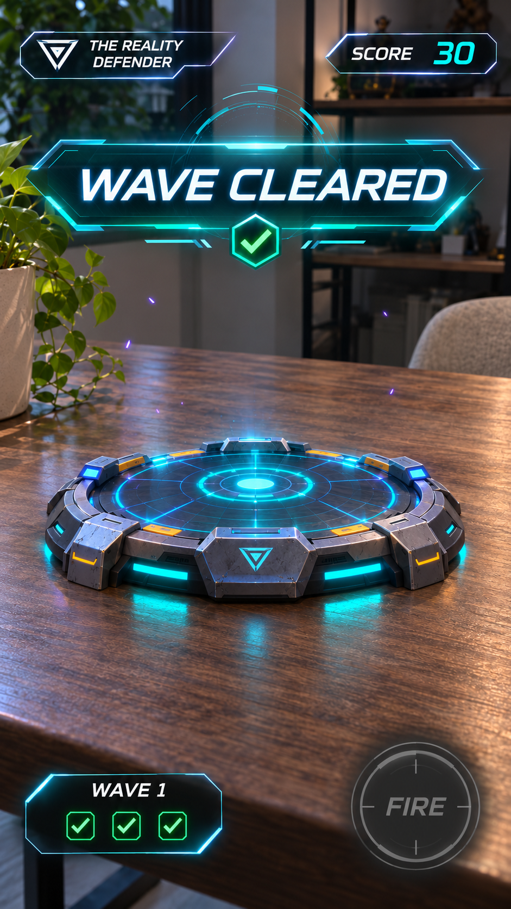

# The Reality Defender — Master build prompt

Open `D:\Unity Projects\Assignment` as the Codex workspace and send the following request in a build session.

> Read `Docs/MASTER_PROMPT.md` in full and execute it in this Unity project. Choose and dispatch five parallel workers by the work that is ready. Use the matching skills in `Docs/CodexSkills/`, integrate the game, build the Android APK, and verify every requirement you can reproduce. Return the APK, assignment evidence, and the exact status of each device check.

Unity asset paths, build outputs, and submission paths in this prompt are relative to the project root. The linked brief, skills, and images are relative to this document.

## 1. Goal and source of truth

Build **The Reality Defender**, a one-wave handheld AR target-practice game in the existing Unity project. This is an implementation prompt. Complete the actual Unity scene, prefabs, scripts, Shader Graph, Android build, and locally obtainable evidence when executing it.

- The user's request sets the scope, assets, Android delivery, low-end support, and worker count. The [assignment PDF](<Mixed Reality Game Dev Assignment.pdf>) specifies the gameplay and review evidence below. If the PDF is unavailable in a future checkout, use the acceptance criteria captured here.
- Use the supplied models for the shipped visuals. Open the [five uploaded mockups](#uploaded-visual-targets) before authoring art or UI. They set the visual target for the base, first-person railgun, HUD, placement feedback, orb energy, and completion banner. Use the five generated views as a consistent guide to each game state. Take the rules for target count, score, firing, and anchoring from the assignment.
- The brief budgets 48 hours. Build the complete scan-to-clear path before polishing. The brief's Google Drive instruction is a submission requirement for the user. Treat upload, public link sharing, and sending the link as separate user-authorized actions.

| Source | Required behavior or artifact |
| --- | --- |
| PDF p. 1, Arena | Use AR Foundation. Detect horizontal floors and tables. Place one Game Base only on a deliberate tap on a detected plane. Align the base with the surface normal and keep it anchored in that session. |
| PDF p. 1, Juice | Apply a custom Shader Graph material to the floating targets. Give them a visible energy effect with Fresnel rim lighting and scrolling noise. Include a small Particle System burst on destruction for the bonus. |
| PDF p. 2, Weapon and logic | The `FIRE` button launches a physical `Rigidbody` projectile from the live Main Camera's position along its forward direction. The base spawns exactly three floating targets. Each accepted collision removes one target, plays hit feedback, and adds 10. Destroy a missed shot once it travels more than 5 m. |
| PDF p. 2, Feedback | Show a live score in a screen corner. At the third valid hit, display `WAVE CLEARED` with a final score of 30. |
| PDF p. 2, Review | Capture a real AR screen recording of plane detection, tap-to-place, and all three hits. Capture the actual Shader Graph in Unity. The brief requests a Google Drive link with anyone-with-the-link Viewer access for submission. |
| User request | Combine the pedestal and platform, use the railgun turret and energy orb, deliver a single installable Android APK, and support low-end phones within the verified platform limits. |

### Visual target from the uploads

Use the landscape mockup as the main gameplay composition and the portrait mockups for the narrow layout. The camera feed should dominate the viewport. Keep the arena low in frame, three electric orbs above it, and the center open for aiming. The base is charcoal metal with chamfered armor, bright electric-blue concentric deck rings, narrow cyan vents, and small amber hazard accents. Use a dark cobalt orb core, hot violet-magenta veins, and a sharp cyan rim. Carry the same colors into the hit burst.

Build HUD plates with translucent navy fill, thin cyan angled borders, bold slanted title lettering with a small reticle or shield mark, and prominent score digits. Reserve warm red-orange for the large round `FIRE` control, amber for `+10`, and green for anchor and completion checks. Make the supplied railgun a compact first-person viewmodel along the bottom of the camera view. The physical shot uses the live camera pose in AR and the virtual camera pose in Practice Mode.

## 2. Dispatch five workers by activity

The primary Codex agent owns integration and final acceptance. After a short read-only inventory, choose five independent assignments from the open work and start all five subagents before waiting for any of them. Each worker selects the matching skill, inspects the relevant inputs, and returns its changed paths or review notes, checks, and blockers. The table gives the initial split for this project. Reassign a completed lane to a distinct verification task when appropriate.

| Activity | Skill to load | Exclusive ownership and handoff |
| --- | --- | --- |
| AR capability, placement, and tracking | [unity-ar-placement](CodexSkills/unity-ar-placement/SKILL.md) | AR startup and placement scripts, tap-to-anchor and tracking recovery. Return the placement result and active camera interface for the shared wave. |
| Model intake and assembly | [unity-ar-assets](CodexSkills/unity-ar-assets/SKILL.md) | Imported models, materials, the combined arena, and a lightweight railgun viewmodel. Return a surface-level origin, three target sockets, and the source-derived orb and railgun prefabs. |
| Camera firing, physics, and wave HUD | [unity-target-gameplay](CodexSkills/unity-target-gameplay/SKILL.md) | Shared game loop, projectile and target scripts, practice aim, viewmodel state, and responsive HUD. Return the serialized references and focused gameplay verification. |
| Shader Graph and feedback | [unity-mobile-vfx](CodexSkills/unity-mobile-vfx/SKILL.md) | Target Shader Graph and material, impact particles, and mobile readability. Return the target visual material and an impact effect that consumes an accepted hit. |
| Android build and evidence | [unity-android-delivery](CodexSkills/unity-android-delivery/SKILL.md) | Android preflight, build method, artifact inspection, compatibility tests, and evidence checklist. Return the verified artifact paths and observed device coverage. |

Read each skill directly from the linked path during the run. For automatic discovery, the user can copy the five directories from `Docs/CodexSkills/` into the project's `.agents/skills/` and reopen the workspace in Codex. [Codex skill discovery](https://learn.chatgpt.com/docs/build-skills#where-codex-loads-local-skills).

In a configurable Codex session, the user can set `max_concurrent_threads_per_session = 5` under `[agents]` in `~/.codex/config.toml` before launching the build. The setting counts spawned workers separately from the primary agent. Respect the session's actual limit. If fewer slots are available, start as many as fit, queue the remaining lanes, and report actual concurrency. [Codex subagent configuration](https://learn.chatgpt.com/docs/agent-configuration/subagents).

### Integration contract

- Keep Unity runtime additions under `Assets/RealityDefender/`. Use `Runtime/AR`, `Runtime/Gameplay`, `Runtime/UI`, `Art/Models`, `Art/Materials`, `Art/Shaders`, `Art/VFX`, `Prefabs`, `Scenes`, and `Editor` as needed. Keep design references outside `Assets`.
- Give each worker its own writable paths. The primary agent owns `Packages/`, `ProjectSettings/`, build profiles, URP renderer settings, and the final scene. The primary agent serializes all editor operations, import actions, and build runs against this project. Workers can inspect files, write disjoint scripts, and prepare import steps concurrently. Merge existing work carefully and use one Unity Editor per project. Use Unity's serialization tools for scenes, prefab links, and asset metadata.
- `GameBase.prefab` exposes a surface-level origin and exactly three `TargetSlots`. Placement instantiates the base at local identity under the accepted anchor or virtual placement root and hands the placed base and active `Camera` to the wave controller. The controller initializes one wave from the slots and publishes score, remaining count, and completion to the HUD. An accepted hit exposes a world position for impact VFX and the projected `+10` indicator. AR and Practice Mode reuse the same base, target, projectile, HUD, and railgun viewmodel prefabs.
- Begin the parallel lanes with the interfaces and visible acceptance gates above. The asset worker can prepare exports, the VFX worker can prepare the graph using an editor preview, and the delivery worker can verify tools while gameplay and AR scripts are in progress. Integrate final art and scene wiring before Play Mode and device QA. If a lane is blocked, continue other lanes and return to it with the required input.

## 3. Preflight and lock the build inputs

1. Read `ProjectSettings/ProjectVersion.txt`, `Packages/manifest.json`, `Packages/packages-lock.json`, active Quality and Graphics settings, project instructions, and any existing work. This workspace was inspected with Unity `6000.5.5f1`, URP `17.5.0`, Input System `1.19.0`, and no AR Foundation or ARCore dependencies. Preserve the existing editor version and packages unless package resolution exposes a specific incompatibility. Use the existing Mobile URP renderer as the starting point.
2. Verify the editor and Android Build Support with SDK, NDK, and OpenJDK in Unity Hub. The local installation was found under `C:\Program Files\Unity\Hub\Editor\6000.5.5f1\Editor`. In Unity, verify the paths under **Edit > Preferences > External Tools**. Check Unity licensing, package resolution, a clean compile, and the intended Android build target before editing runtime assets.
3. Resolve `com.unity.xr.arfoundation` and `com.unity.xr.arcore` at `6.5.1`, the released pair for this editor line. Let Package Manager resolve XR Plug-in Management and XR Core Utilities. Inspect the resolved lock file and confirm the Shader Graph package brought in by URP. Configure Google ARCore for Android under **Project Settings > XR Plug-in Management**. Set **Requirement** to **Optional**. Keep Depth optional and leave depth/occlusion components out of the baseline scene. Fix Android XR Project Validation errors before building. [AR Foundation releases](https://docs.unity3d.com/6000.5/Documentation/Manual/com.unity.xr.arfoundation.html), [ARCore releases](https://docs.unity3d.com/6000.5/Documentation/Manual/com.unity.xr.arcore.html), [ARCore project setup](https://docs.unity3d.com/Packages/com.unity.xr.arcore@6.5/manual/project-configuration-arcore.html).
4. Add `ARBackgroundRendererFeature` to the Universal Renderer actually selected by the Android Mobile quality level and the AR camera. Verify the camera preview and background in a device build. Keep GLES3 as the baseline graphics API. [AR Foundation URP setup](https://docs.unity3d.com/Packages/com.unity.xr.arfoundation@6.5/manual/project-setup/universal-render-pipeline.html).
5. Track setup decisions and build evidence in `Submission/Verification.md`. If a tool, license, package fetch, or USB device blocks a step, record the observed error and complete the work that can be verified locally.

## 4. Import the supplied models and assemble one base

| Purpose | Existing project source | Import decision |
| --- | --- | --- |
| Pedestal, lower support | `Assets/Game_Assets/Base/sci-fi-pedestal/source/pedestal_low.fbx` and `textures/` | Inspect imported axes, scale, mesh bounds, submeshes, and actual material slots. The lower ring supplies visible contact with the plane. |
| Platform, upper deck | `Assets/Game_Assets/Base/sci-fi-platform/source/Sci-Fi Platform.zip` | Stage `platform/Platform.fbx` and needed textures from the archive. The existing `Base Color.png` and `Normal.png` duplicate the archived maps. Inspect the archive's other maps before adding any to the build. |
| First-person railgun | `Assets/Game_Assets/Weapon/railgun-turret/source/Railgun turret.blend` and `textures/` | Use Blender to export the visible barrel and upper housing to FBX for `RailgunViewmodel.prefab`. Omit the swivel stand from the derivative. Preserve the `.blend`. Verify the source-derived silhouette, orientation, and material bindings. Blender 5.2 was found installed. |
| Energy orb | `Assets/Game_Assets/energy_orb.glb` | Import with a compatible released Unity glTFast package or export a static derivative through Blender. Preserve a visibly source-derived mesh. The GLB has 12 meshes and about 11,520 indexed triangles with a nearly transparent material. Inspect the shells and use one useful source shell or a lightweight merged derivative with the custom target material. |

1. Inspect the assembly from above, profile, and a phone-like three-quarter camera angle. Set Unity scale to one unit per meter. Normalize each visual child under `GameBase` and center its footprint on local X/Z. Sit the pedestal's lowest visible contact at local `Y=0` and seat the platform tightly on top. Keep local root scale `(1,1,1)`. Start around `0.65 m` base diameter, then adjust fit and visibility on both a floor and a table. Use a soft low-cost contact decal only if needed to improve grounding.
2. Build `GameBase.prefab` with `PedestalVisual`, `PlatformVisual`, and `TargetSlots`. Keep both source shapes readable and leave the blue concentric deck open. Start with three slots across a shallow arc at local `X = -0.23, 0, +0.23 m`. Place them roughly `0.24, 0.36, 0.24 m` above the surface and adjust for deck clearance. Start with `0.12–0.15 m` orb diameters. Frame them with the center orb slightly higher. Verify all three are independently aimable from a natural handheld position in both layouts.
3. Create URP-compatible materials. Import albedo and authored emission color in sRGB, normals as Normal maps, and linear masks as data. Inspect packed channels and use `1 - roughness` where smoothness is needed. Match the uploads with dark segmented armor, crisp cyan rim vents, a bright blue central ring and fine deck lines, plus small amber safety inserts. Use modest Android texture overrides, usually `512–1024 px` to start. Keep material sources traceable to the imported models and textures.
4. Author `RailgunViewmodel.prefab` separately with the source-derived barrel and housing, a restrained cyan grille, one local presentation pivot, and no colliders or Rigidbody. Attach it to the active gameplay camera at runtime. Fit it beyond the near plane and keep it in roughly the lower fifth of the viewport in the usual aim pose. Set its layer and offset so it stays clear of the aiming reticle, targets, and `FIRE` button. Keep the physical spawn transform and 5 m range independent of the viewmodel and any cosmetic recoil.
5. Record asset credits in `Submission/AssetCredits.md`. The GLB metadata identifies **Energy Orb** by **tamminen**, licensed CC BY 4.0. Credit the author, link the source and license, and note derivative mesh and material changes. Inspect the other asset terms before redistribution and record unknown provenance accurately. [Energy Orb source](https://sketchfab.com/3d-models/energy-orb-c37063dad7a046fb84649ad5a621bb55), [CC BY 4.0](https://creativecommons.org/licenses/by/4.0/).

## 5. Build the AR and Practice startup flows

1. Create `Assets/RealityDefender/Scenes/RealityDefender.unity`. Wire one bootstrap and UI event system. Put `ARSession` in the AR branch. Configure one `XROrigin` at unit scale with `ARPlaneManager`, `ARRaycastManager`, and `ARAnchorManager`. Use the package's **XR Origin (Mobile AR)** and **AR Session** scene setup to wire the tracked camera, its pose driver, `ARCameraManager`, and `ARCameraBackground`. Only the chosen mode's camera and audio listener are active during play. Use the Input System UI module with the project's touch input and connect explicit camera references. [AR Foundation scene setup](https://docs.unity3d.com/Packages/com.unity.xr.arfoundation@6.5/manual/project-setup/scene-setup.html).
2. Initialize the Android XR loader before querying it. Check `ARSession.CheckAvailability()` and handle the session states. Use one explicit install/update flow with `ARSession.Install()` for `NeedsInstall`, and disable `ARSession.attemptUpdate` when managing that flow. Request camera permission when the user enters AR. Start the tracked camera and plane managers after availability, services, and permission pass. Give failed initialization, denied permission, or an unavailable provider a retry path and a `Practice Mode` entry. Keep both entry paths usable on resume. [AR Foundation session API](https://docs.unity3d.com/Packages/com.unity.xr.arfoundation@6.5/api/UnityEngine.XR.ARFoundation.ARSession.html), [Google AR Optional requirements](https://developers.google.com/ar/develop/java/enable-arcore).
3. On supported devices, guide the user with `Move your phone slowly over a well-lit table or floor`. Request horizontal detection and visualize tracked, upward-facing plane bounds with a perspective-correct cyan dotted mesh and a thin border. Show a segmented placement reticle and `Tap the highlighted surface` when a usable plane is available. Wait for tracking and ignore taps over interactive UI or outside a usable plane.
4. Raycast from the actual screen touch with `TrackableType.PlaneWithinPolygon`. Filter hits to a tracked `HorizontalUp` plane. Create the world pose from the hit position, the plane's up normal, and a yaw aligned with camera forward projected onto that plane. Use a planar fallback axis when the camera points nearly straight down. Enter `Placing` before awaiting `TryAddAnchorAsync(worldPose)`. Accept a single successful anchor and wait for tracking. Parent `GameBase` at local identity, fade the broad scan mesh, and show a short green `BASE ANCHORED` confirmation. Start the wave after placement from the same tap. Use a faint cyan-green dotted footprint or thin ring local to the anchor for the locked-on look in the gameplay mockup. On failure, return to scanning. Drop late results after teardown or mode changes and remove their anchors. [AR Foundation Anchor Manager](https://docs.unity3d.com/Packages/com.unity.xr.arfoundation@6.5/manual/features/anchors/aranchormanager.html).
5. Keep the base and sockets on that one anchor as the player moves. Suppress placement and firing while tracking is limited or the app is suspended, and retire any in-flight shots without scoring. On recovery, reuse the same valid anchor. If it is lost, provide a clear way to start a new placement session with all old content cleaned up. Verify that repeated screen taps, UI touches, backgrounding, rotating the phone, and relocalization preserve one base and one wave in the active session.
6. For **Practice Mode**, use a virtual floor or tabletop and a fixed-position virtual camera. Let a world tap place the same base at a playable pose on the virtual surface. While playing, drag the free play area to rotate the virtual camera in yaw and pitch. Separate drag, placement, and UI input, and check that all three slots can be aimed at comfortably. Keep a persistent `PRACTICE MODE` label and show `BASE PLACED` as the confirmation. Run without AR tracking, a live camera feed, or AR services, with the same projectile range, physics, and scoring as AR.

## 6. Implement the wave, firing, and HUD

1. Create `EnergyTarget.prefab` with the source-derived visual and a centered, non-trigger `SphereCollider`. Spawn exactly three instances from the placed base's `TargetSlots`. Keep colliders aligned with visible targets. Use the shader for energy motion so the target location remains stable and easy to aim at. Keep score and remaining-target state in one wave controller. Initialize `SCORE 0` only once per wave.
2. Create `Projectile.prefab` with a non-kinematic `Rigidbody`, a small non-trigger sphere collider, and zero gravity and damping. Start with `Continuous` collision detection for stationary target colliders and verify it at the chosen speed and timestep. Use a dedicated projectile/target collision pair. Enable input only during the active wave. On `FIRE`, capture the live camera position and forward vector, spawn at that position, and assign `Rigidbody.linearVelocity` once along camera forward. Keep the projectile independent of the camera and anchor transforms. Start around `10–12 m/s` with a short fire cooldown. Verify visible motion after the projectile clears the camera near plane. Use physical contact to determine a hit. [Unity 6 Rigidbody velocity API](https://docs.unity3d.com/6000.5/Documentation/ScriptReference/Rigidbody-linearVelocity.html), [Unity collision detection modes](https://docs.unity3d.com/6000.5/Documentation/Manual/choose-collision-detection-mode.html).
3. Resolve `OnCollisionEnter` through the wave controller. Accept at most one hit per projectile and one per live target. Check the active wave and the 5 m firing range before awarding points. Guard against collisions from stale projectiles and simultaneous duplicate callbacks. Disable the accepted target's collider and visual immediately, play the burst at the hit location, increment score by 10, and consume the projectile. After the third accepted hit, disable `FIRE` and display `WAVE CLEARED` over the anchored base with `SCORE 30` still visible.
4. Track straight-line displacement from the launch position to the physics body in world meters. Apply the same body-position range check in the collision callback. Destroy missed projectiles once the body exceeds 5 m, and reject out-of-range shots when the collision arrives on the same physics step as expiry. Clear outstanding projectiles when the wave ends or the mode shuts down. A conservative lifetime failsafe can clean up a stalled projectile. Keep projectile and VFX instance counts bounded during rapid taps.
5. Bind `RailgunViewmodel` to the active AR or Practice camera after placement. Show it low in the view while playing. On an accepted fire input, give it a short cosmetic recoil and a compact muzzle flash if the mobile budget allows. Use a brief fading projectile trail for the moving shot. Keep the reticle and all physics tied to the camera-forward axis throughout the animation. Hide the model during scanning and lower or hide it at completion.
6. Build a responsive screen-space Unity HUD from the uploaded mockups. Use reusable dark navy chamfered panels, thin electric-cyan trim, a compact bold game title, and clearly separated score digits. Use `Screen.safeArea` for labels and the round lower-right `FIRE` button. Keep the button comfortably thumb-sized and the center clear. In landscape, spread the title and score across the top and place the compact wave/status strip along the bottom. In portrait, keep the score in a top corner, reduce the title width, and keep the bottom-left progress and right-hand `FIRE` control apart. Use the mockups' decorative glyphs as style cues and ship only controls with a wired action. Reflow on screen-size, safe-area, or orientation changes. Align the small white segmented reticle to the projected camera-forward axis after camera projection updates. [Unity Screen.safeArea](https://docs.unity3d.com/6000.5/Documentation/ScriptReference/Screen-safeArea.html).

| HUD state | Visible feedback |
| --- | --- |
| Scanning | Game title, a clear scan or tap prompt, and the placement indicator on valid geometry. `FIRE` appears when the wave becomes active. |
| Placement confirmed | A brief green check with `BASE ANCHORED` while the arena stays registered to the surface and the three targets appear. |
| Active wave | `SCORE 0`, then `SCORE 10` and `SCORE 20`. Use a compact `WAVE 1` and `TARGETS 3/3` status strip with live remaining counts. Show the warm red-orange `FIRE` control and camera reticle. |
| Hit | Show an amber `+10` briefly near the visible impact and update the one score display and remaining count from the accepted-hit event. The local violet-white burst leaves the two surviving orbs distinct after the first hit. |
| Cleared | Large white `WAVE CLEARED` in a wide cyan-edged panel with a green check. Keep `SCORE 30` and three completed ticks visible over the empty anchored arena. Dim `FIRE` and set it non-interactable. |

## 7. Author the Shader Graph and hit feedback

1. In Unity, create an editable **URP Unlit Shader Graph** at `Assets/RealityDefender/Art/Shaders/SG_EnergyOrb.shadergraph`. Start with one opaque, single-sided shell. Use `UV0 + Time × ScrollSpeed` to sample a small seamless grayscale vein texture. Remap its soft values to dark cobalt and violet, and its narrow bright ridges to bright magenta and electric blue. Blend to a crisp cyan rim with `Fresnel Effect` using matching world-space normal and view direction. Expose colors, scroll, rim power, and rim strength. Route the blended color to Unlit Base Color. Keep the branching electric pattern visible with bloom disabled. [Shader Graph Fresnel node](https://docs.unity3d.com/Packages/com.unity.shadergraph@17.5/manual/Fresnel-Effect-Node.html).
2. Save `M_EnergyOrb` using the graph and assign it to the renderer in the target prefab. Confirm that all three spawned targets use it. If the mobile budget allows, echo the uploaded silhouette with small broken cyan brackets around each orb and a faint blue lift accent rising from its socket. Keep these accents local, unlit, and decorative. Check the Game view and Android device for texture seams, shader compile errors, readability on bright and dark camera feeds, and correct hits near the edge of the visible orb.
3. Build a short, non-looping Unity Particle System for the accepted hit event. Use a tight violet-white flash and 12–16 cyan and magenta sparks with a `0.2–0.4 s` lifetime. Add a thin expanding ring only if it reads cleanly against the camera feed. Use a low-cost unlit particle material and a bounded reusable pool. Spawn it independently so the burst continues after the target disappears. Disable particle collision, lights, and other costly modules in the baseline. Take a readable screenshot showing the saved graph's scroll, vein texture, Fresnel, and output wiring after it compiles.

## 8. Optimize and verify before packaging

- Plan for **Android 8.0/API 26 or newer, a supported ABI, and an OpenGL ES 3 capable GPU**. For tracked AR, require an ARCore-certified model, suitable sensors and camera conditions, Google Play Services for AR, and camera permission. A camera's megapixel count alone does not establish tracking support. On other compatible Android devices or when AR is unavailable, offer Practice Mode. APK delivery targets Android. [Unity 6.5 Android requirements](https://docs.unity.com/en-us/engine/6000.5/manual/platform-specific/android/introducing/requirements-and-compatibility), [Google's ARCore device list](https://developers.google.com/ar/devices).
- Set a 30 fps baseline and profile on a modest device. Start with the Mobile Forward renderer, one cheap lighting setup, HDR and post-processing off, minimal shadows, conservative texture budgets, and ETC2 as a broadly compatible Android compression baseline. Keep AR depth, scene meshing, and CPU camera image readbacks out of the normal path. Prefer the provider's default camera configuration. Test a lower provider-supported camera configuration only before placement and only if the camera is the measured bottleneck and tracking remains usable. If rendering is the bottleneck, reduce render scale, shader work, or overdraw while preserving HUD legibility.
- Check steady play and three-hit bursts with Unity Profiler on a development build. Record model, Android version, ABI, AR service version, scene conditions, mean FPS, p95 frame time, memory and GC behavior, and tracking issues. For the final APK, use a repeatable warm-device run of at least two minutes without profiler or screen recorder overhead. Start with a target of roughly 30 fps and p95 frame time at or below 40 ms on the tested low-end device. Document any untested device tier.

| Verification | Expected observable result |
| --- | --- |
| Editor Practice Mode | Tap the virtual surface once, aim at all three orbs, and clear the wave with three real collider hits. Check the reference layout in wide and tall aspect ratios, the safe area, and the viewmodel crop. |
| Physics checks | Fire along camera forward. A direct hit consumes one target and scores once. A deliberate miss leaves score unchanged and disappears after 5 m. Rapid or duplicate contacts preserve the score and remaining count. A hit beyond range earns zero. |
| Certified phone, floor and table | Scan in a well-lit textured area. Tap outside the detected plane and over a control, then place on a valid plane. Verify base alignment and one anchored base as the phone moves. Hit all three orbs. Repeat placement in a fresh session on the other surface. |
| Tracking and lifecycle | Pause, resume, and briefly lose tracking. Recover the existing valid anchor or offer a clear new-session recovery. Check permission denial and service installation/cancellation where available. |
| Visual and rotation check | Compare setup, gameplay, first hit, and clear against the uploaded mockups. Rotate on a certified phone with rotation enabled. Verify the background and reticle align, the HUD reflows, and the arena, score, and remaining targets are preserved. |
| Unsupported or restricted device | Launch into a usable flow with Practice Mode. Play all the way to `WAVE CLEARED` without camera permission. Keep this evidence separate from tracked AR evidence. |
| Low-end Android | Verify shader and HUD readability on a modest camera feed, run the frame-time and memory check, and repeat the wave on the final APK. |

Use Play Mode or XR Simulation for iteration and record that test category. Use physical Android hardware for claims about plane detection, real-world anchoring, AR performance, and APK device coverage.

## 9. Build the APK, capture evidence, and hand off

1. In **File > Build Profiles**, activate Android and include `RealityDefender.unity` as the first enabled scene. In Android Player settings, use product name `The Reality Defender`, keep any existing agreed package ID or set `com.assignment.realitydefender`, set minimum API 26, and select the installed supported target SDK (API 36 was available at preflight). Under **Resolution and Presentation**, set **Default Orientation** to **Auto Rotation**, allow Portrait and both Landscape orientations, and respect the phone's rotation setting. Select IL2CPP and ARM64. Add ARMv7 to the same APK only if package native libraries, project validation, and an appropriate 32-bit device test pass. Record actual supported ABIs. Disable **Export Project**, **Build App Bundle (Google Play)**, per-architecture splitting, and separate application binaries. Confirm the merged manifest is AR Optional and allows installation on fallback-capable devices without AR camera hardware. [Unity Android Player settings](https://docs.unity.com/en-us/engine/6000.5/manual/platform-specific/android/getting-started/class-player-settings#orientation).
2. Build to `Builds/Android/RealityDefender.apk`. First use an internal development build for logging and profiling if useful. Make the final APK a non-development build signed for installation. For a local assignment, Unity's default debug signing can produce a sideloadable APK when a release key is unavailable. Record the signer type. If the user provides an authorized release keystore, use it securely and keep credentials out of source and logs. Require a successful Unity `BuildReport` and verify that the file exists and has a valid signature.
3. For a repeatable batch build, implement `RealityDefender.Editor.AndroidBuild.BuildApk` under `Assets/RealityDefender/Editor/`. Read and validate the intended scene and Android settings, call `BuildPipeline.BuildPlayer` with `BuildTarget.Android` and the APK path, and fail with a nonzero exit code for a failed report. After serializing and closing the GUI editor for this project, run from PowerShell. Create the log folder first and inspect the current run's log and APK timestamp.

   ```powershell
   $project = 'D:\Unity Projects\Assignment'
   $unity = 'C:\Program Files\Unity\Hub\Editor\6000.5.5f1\Editor\Unity.exe'
   $log = Join-Path $project 'Builds\Android\Unity-build.log'
   New-Item -ItemType Directory -Force -Path (Split-Path -Parent $log) | Out-Null
   $unityArgs = @('-batchmode', '-quit', '-projectPath', ('"{0}"' -f $project),
     '-buildTarget', 'Android', '-executeMethod', 'RealityDefender.Editor.AndroidBuild.BuildApk',
     '-logFile', ('"{0}"' -f $log))
   $run = Start-Process -FilePath $unity -ArgumentList $unityArgs -WindowStyle Hidden -Wait -PassThru
   if ($run.ExitCode -ne 0) { throw "Unity Android build failed. See $log" }
   ```

4. Inspect the APK with SDK tools. Run `apksigner verify --print-certs` and inspect the final manifest with `apkanalyzer manifest print` or equivalent. Check package ID, minimum and target SDK, supported ABIs, launcher activity, signing, and optional AR metadata. Use `Get-FileHash -Algorithm SHA256` for the delivered APK. With a designated Android test device attached and authorized, use `adb devices -l` then `adb -s <serial> install -r <apk-path>` and launch from the device. Inspect logcat for camera background, shader, plugin, and startup failures. A signing conflict requires the matching signer or a user-approved clean installation.
5. Capture `Submission/RealityDefender-AR-demo.mp4` from a certified device. Start before placement. Show the camera and tracked plane visualization, the intentional tap, the grounded base while the phone moves, all three hits, the score progression to 30, and `WAVE CLEARED`. Use the Android screen recorder or `adb shell screenrecord` and pull the result. Capture `Submission/RealityDefender-ShaderGraph.png` from the actual Unity Shader Graph editor at a readable zoom. Verify both files open. If hardware or capture is unavailable, give the exact remaining capture steps in `Submission/Verification.md` and mark the corresponding acceptance row pending.
6. Deliver the APK path, checksum, Unity build log or BuildReport summary, device results, capture paths, and credits. For the assignment submission, gather the APK, recording, and Shader Graph image. After the user reviews the files and authorizes sharing, set the chosen Drive folder or files to **Anyone with the link > Viewer**, confirm the accessible link, and hand it back for submission. [Unity Android build workflow](https://docs.unity3d.com/6000.5/Documentation/Manual/android-BuildProcess.html).

## 10. Visual references

### Uploaded visual targets

These five uploaded mockups govern the art direction. Use the assignment rules in Section 1 for placement, counts, scoring, and shot behavior.

| Uploaded image | Match in the Unity build |
| --- | --- |
| [01 — Landscape gameplay](GameReferences/supplied/01-landscape-hud.png) | Main composition, open aiming area, cyan-ring arena, violet plasma, angular HUD, and circular warm `FIRE`. |
| [02 — Surface scan and placement](GameReferences/supplied/02-placement-flow.png) | Cyan dotted plane, segmented placement indicator, and green anchor confirmation on the same tap. |
| [03 — Landscape hit feedback](GameReferences/supplied/03-landscape-hit-feedback.png) | Compact foreground railgun, bright violet-white impact, amber `+10`, and top-to-bottom HUD hierarchy. |
| [04 — Portrait hit feedback](GameReferences/supplied/04-portrait-hit-feedback.png) | Narrow-screen fit for the camera-mounted railgun, two surviving orbs after the first hit, and a reachable `FIRE` control. |
| [05 — Wave cleared](GameReferences/supplied/05-wave-cleared.png) | Large angular `WAVE CLEARED` banner, green confirmation checks, score 30, and open blue-lit deck. |

The [original pedestal reference](GameReferences/supplied/00-original-base.png) informs the mechanical assembly and layered circular silhouette. The five mockups set the blue and cyan lighting palette.

<details>
<summary>View the five uploaded mockups</summary>











</details>

### Generated game references

The five revised views use the uploaded mockups as direct ImageGen inputs and show the game from setup to completion. Use the supplied meshes and live Unity UI to build the look.

#### 01 — Combined pedestal and platform



Match the tight seam, low segmented skirt, wider upper deck, and unobstructed blue reactor ring.

#### 02 — Scan and confirm placement



Use the left frame for scanning and the right for the instant of confirmation. The wave begins from that same placement tap.

#### 03 — Landscape gameplay



Keep three separate orb silhouettes, one score, and a clear camera reticle. Match the cyan and violet contrast and reserve warm color for the action control.

#### 04 — First hit in portrait



The short projectile trail and local burst communicate the hit. The first hit removes one target and leaves two aimable orbs.

#### 05 — Wave cleared



Keep the score and completed checks visible. The anchored arena remains in view, and firing is disabled.

<details>
<summary>ImageGen prompts and source images</summary>

The built-in ImageGen tool used this shared direction with each image brief.

> Create a production reference for The Reality Defender, an Android AR target-practice game. Use the attached game mockups as the primary design references. Match their electric-blue and cyan tech lighting, violet and magenta plasma arcs, smoky near-black chamfered HUD frames, crisp white typography, and grounded mixed-reality scale. Use the same arena in each view: a low two-piece charcoal metal circular arena, segmented lower pedestal, wider beveled upper platform, a blue concentric reactor ring in a clear deck, vivid cyan vents, and only small amber safety accents. Compose the scenes as clean art or direct game viewport views. Keep lighting believable, the contrast of the UI high, and light effects local. Avoid device bezels, OS chrome, people, watermarks, and logos other than the requested game title.

**01 — Combined pedestal and platform**

Uploaded inputs in order are [01-landscape-hud.png](GameReferences/supplied/01-landscape-hud.png), [05-wave-cleared.png](GameReferences/supplied/05-wave-cleared.png).

> Use image 1 to match the angular cyan-lit pedestal and image 2 to match the stepped concentric deck, trim and scale. Create a landscape 16:9 three-quarter studio render of just the assembled sci-fi arena. Show the lower pedestal's segmented support skirt fitted flush to the broader platform above, a visible seam, angular charcoal armor, an unobstructed bright cyan-blue concentric center ring, a fine blue deck grid, and small amber hazard inserts. Keep the profile low and compact, fully in frame on a dark neutral background with a grounded contact shadow. No floating orbs, weapons on the platform, panels, or words.

**02 — Scan and confirm placement**

Uploaded inputs in order are [02-placement-flow.png](GameReferences/supplied/02-placement-flow.png), [01-landscape-hud.png](GameReferences/supplied/01-landscape-hud.png).

> Use image 1 as the reference for the scan-to-anchor sequence and HUD. Use image 2 to lock the arena shape and cyan light color. Create one diptych of two adjacent tall 9:16 in-game viewports separated by a narrow dark gutter. Both show the same real light gray textured indoor floor and same camera angle. Left panel before the tap: no arena, just a perspective-correct fine cyan dotted tracking polygon and a small segmented white placement reticle. Right panel on the instant the tap is confirmed: the compact blue-ring platform rests flush on the floor at the matched spot and the scan grid has faded. No orbs or gun in either panel. At the top of each, a restrained angular cyan title panel reads 'THE REALITY DEFENDER'. At the lower left of the left panel, one clear prompt reads 'Tap the highlighted surface'. On the right, a small green checked confirmation panel reads 'BASE ANCHORED'. Keep the layout close to the uploaded reference with real room depth, phone-sized text, and exactly those words.

**03 — Landscape gameplay with three orbs**

Uploaded inputs in order are [01-landscape-hud.png](GameReferences/supplied/01-landscape-hud.png), [03-landscape-hit-feedback.png](GameReferences/supplied/03-landscape-hit-feedback.png), [04-portrait-hit-feedback.png](GameReferences/supplied/04-portrait-hit-feedback.png).

> Use image 1 as the primary composition and plasma reference. Use images 2 and 3 for the camera-mounted railgun silhouette and angular HUD. Create a full-bleed landscape 16:9 Android gameplay viewport over a real wood table. Match the uploaded image's strong cyan-lit arena and triangular three-orb silhouette. Exactly three intact dark blue energy spheres float clearly apart in a shallow arch, one center slightly higher, each with a bright electric cyan rim and distinctive vivid violet-magenta branching veins. Show a small cropped, cool-cyan-lit twin-rail sci-fi emitter entering at the very bottom center, occupying only the lower 12% and leaving the arena and reticle clear. Keep the platform empty of weapons. Include a modest segmented white aiming reticle on the camera axis. The only UI text is 'THE REALITY DEFENDER' in a cyan chamfered top-left plaque, 'SCORE 0' in the top-right, 'WAVE 1' and 'TARGETS 3/3' in a low unobtrusive status strip, and 'FIRE' in a large round warm-red/orange control at the lower right. Small green anchor check lower left. Thin cyan tracking accents at the base edge. Compose like the references, with a direct view into the AR game, no impact yet.

**04 — Portrait hit and +10 feedback**

Uploaded inputs in order are [04-portrait-hit-feedback.png](GameReferences/supplied/04-portrait-hit-feedback.png), [03-landscape-hit-feedback.png](GameReferences/supplied/03-landscape-hit-feedback.png), [01-landscape-hud.png](GameReferences/supplied/01-landscape-hud.png).

> Use image 1 as the primary composition and foreground railgun reference. Use image 2 for violet spark color and energy streaks, and image 3 for the recognizable cyan arena. Make a full-bleed portrait 9:16 Android viewport over a real indoor floor. Capture the instant the first hit has been accepted. Show exactly TWO intact cyan-rimmed violet/magenta energy orbs and one tightly localized violet-white and cyan particle starburst where the third orb vanished. The burst is separate from both surviving orbs. A short amber projectile afterimage points toward the hit and is already fading. Keep a small cropped, stylized cyan-lit twin-rail emitter at the very bottom center with the view around it open. The low blue-ring arena sits flush below the orbs. Use cyan-outlined dark HUD plates and the exact readable text 'THE REALITY DEFENDER', 'SCORE 10', 'TARGETS 2/3', one amber '+10' at the hit, and 'FIRE' on a warm circular bottom-right button. Center the aim reticle around the hit. Preserve the reference's electric game feel with zero cubes, extra orbs, and duplicate score counters.

**05 — Portrait completion**

Uploaded inputs in order are [05-wave-cleared.png](GameReferences/supplied/05-wave-cleared.png), [01-landscape-hud.png](GameReferences/supplied/01-landscape-hud.png).

> Use image 1 as the primary composition, completion banner and type reference. Match the blue-ring base geometry and clean tech frames in image 2. Make a full-bleed portrait 9:16 AR view after the third hit, looking down at the compact arena seated flush on a real wood table. Above the arena, show the exact headline 'WAVE CLEARED' in large white italic block text inside a cyan-edged angular smoky panel, with a green shield check below. In the safe-area top row, show 'THE REALITY DEFENDER' and 'SCORE 30'. At the bottom show a small panel reading 'WAVE 1' with three green completed check marks and a visibly dim disabled circular 'FIRE' control on the lower right. Leave all three positions empty with zero intact spheres and zero projectiles. A few fleeting violet spark motes may appear, without a round outline that resembles a living orb. The deck is unobstructed. Reproduce the visual hierarchy of the uploaded win screen.

</details>
