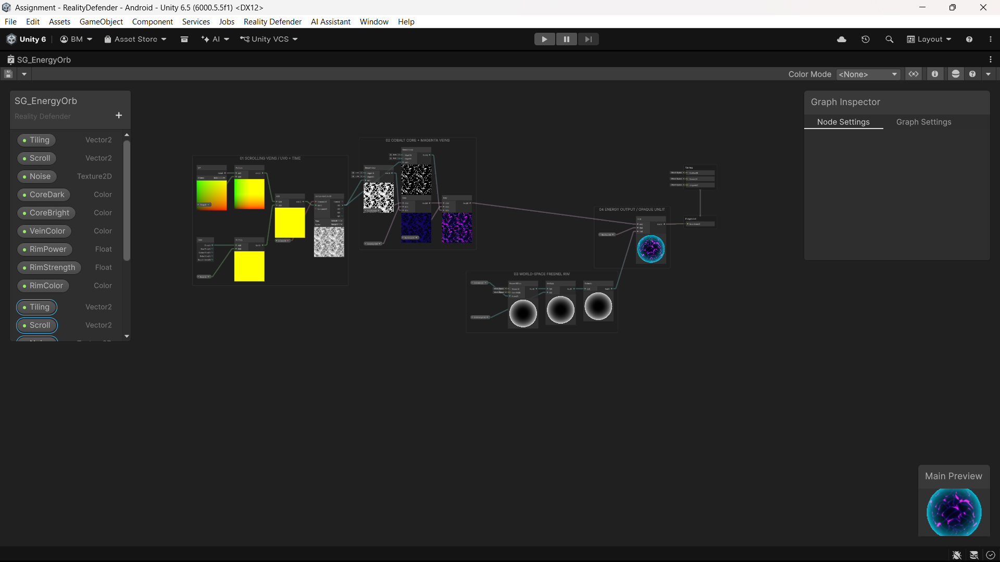
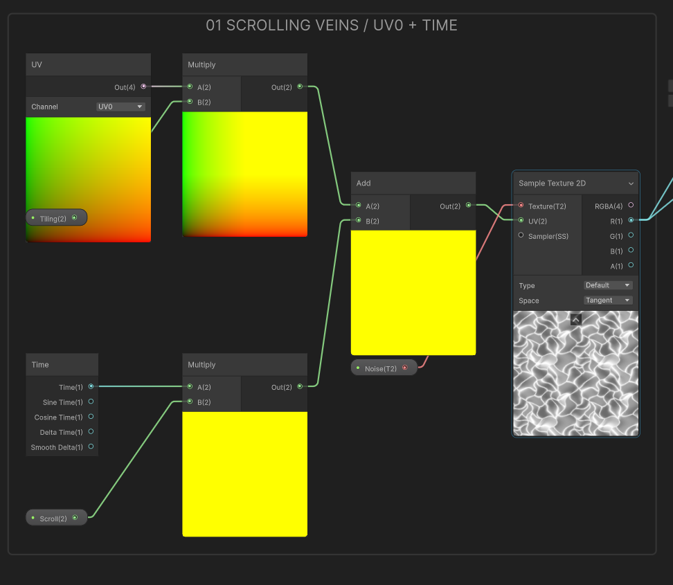
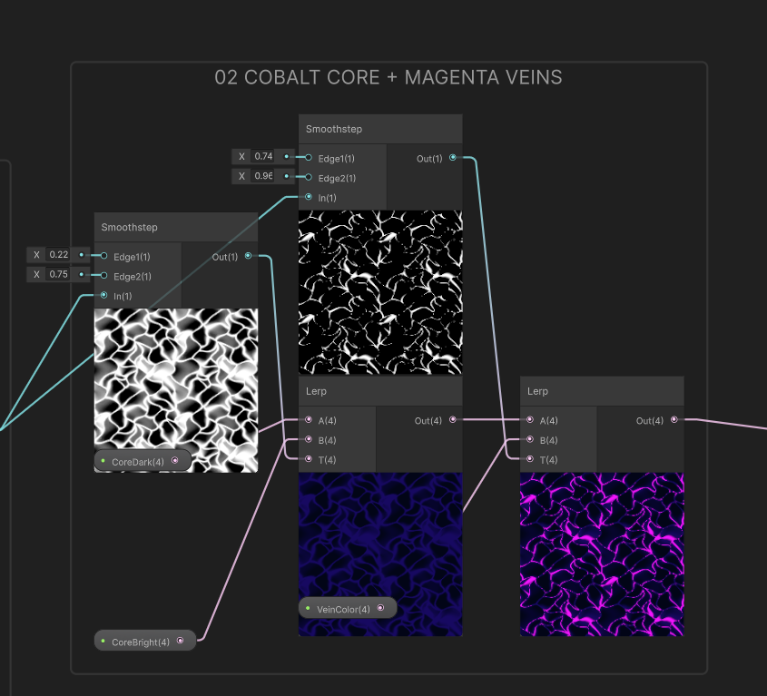
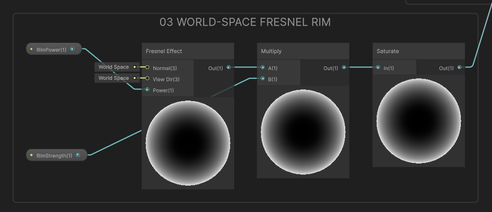
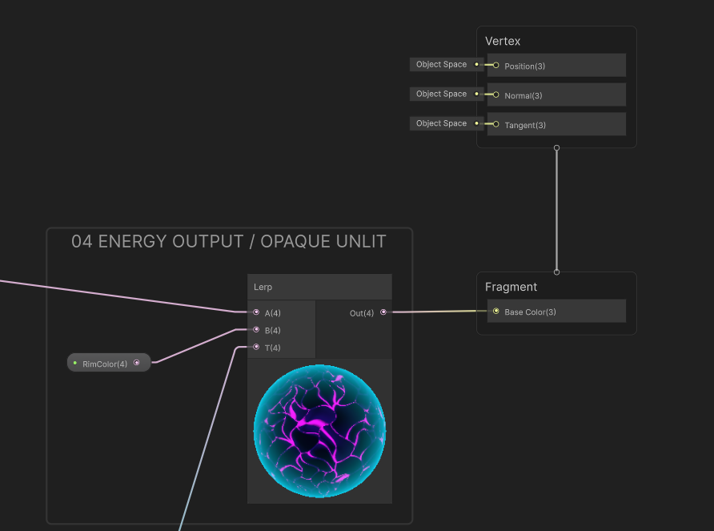

# The Reality Defender — AR Shooting Game

> **YOUR WORLD. YOUR ARENA.**
> Find a surface. Place your base. Aim with your phone and clear three energy targets.

A Unity 6 mixed-reality target-practice game built for the *Mixed Reality Game Dev* assignment.
Runs on any **ARCore-compatible Android phone** as a world-anchored AR experience, or in **Practice Mode** (no AR hardware needed).

| | |
|---|---|
| **Engine** | Unity 6000.5.5f1 |
| **AR Stack** | AR Foundation 6.5.1 · Google ARCore XR Plugin 6.5.1 |
| **Render Pipeline** | URP 17.5 |
| **Target Platform** | Android — IL2CPP · ARM64 · API 26 min / API 36 target |
| **Build** | `Final/RealityDefender.apk` (44.4 MB) |

---

## 📱 Game Overview

### Main Menu

| Practice Mode | AR Mode |
|:---:|:---:|
|  |  |
| Virtual practice floor, no camera needed | Real-world AR via phone camera + ARCore |

Tap **ENTER AR** to launch the full augmented-reality experience, or **PRACTICE MODE** to play on a virtual grid floor without any AR services.

---

## 🕹️ Modes of Play

### Practice Mode
No camera or AR services required. The game renders a virtual practice floor and places the base immediately on tap.

| Step | Screenshot |
|:---:|:---:|
| **Drag-to-aim view — Level 2 "Orbit Storm"** | **Level 3 "Chaos Drift" — Free-flying bubbles** |
|  |  |
| 3 energy bubbles orbiting the base on a tilting carousel | 4 bubbles in random free-flight with inertia and turbulence |

| Wave Cleared! |
|:---:|
|  |
| Level 3 Completed — full-screen aura burst, god rays, shock rings, confetti, and **PLAY AGAIN** |

---

### AR Mode — Real Device (OnePlus 11R · ARCore)

The full pipeline runs on a physical Android device. The game anchors the arena to a real-world horizontal plane and stays put as you move.

| Phase | Screenshot | What's happening |
|:---:|:---:|:---|
| **01 · Scan** |  | "Move your phone slowly to find the ground" — ARCore detects horizontal planes |
| **02 · Level 1 · Still Waters** |  | Base anchored to real floor · 2 static energy bubbles · **BASE ANCHORED** status |
| **03 · Level 2 · Orbit Storm** |  | 3 bubbles orbiting on a tilting carousel over the real floor |
| **04 · Level 2 Completed** |  | Full-screen aura celebration with god rays, confetti, and score count-up |
| **05 · Level 3 · Chaos Drift** |  | 4→1 remaining bubble drifting freely, always inside phone-screen bounds |

---

## 🎯 Levels

| Level | Name | Bubbles | Motion | Destruction Signature |
|:---:|:---|:---:|:---|:---|
| **1** | Still Waters | 2 | Static — fixed in place; soap film swirls | **Rupture** — jelly shock along the shot axis, film tears from impact, core implodes |
| **2** | Orbit Storm | 3 | Rotating — carried around the base on a tilting, precessing carousel | **Singularity** — crushed into a spinning accretion disc that collapses to a point and detonates |
| **3** | Chaos Drift | 4 | Random free flight with inertia, turbulence and avoidance; always clamped inside visible screen and within range | **Fission** — hit-stop, then splits into a swarm of mini bubbles that pop in sequence |

Clearing all three levels scores **90 / 90** and shows the **WAVE CLEARED** panel with **PLAY AGAIN**.

---

## 🔫 The Plasma Lance Projectile

**FIRE** launches a *plasma lance*:
- Electric arcs crackle off the railgun muzzle
- Charge rings blow outward
- A braided double helix of plasma spins around a white-hot core
- Ion rings are shed every half-metre along the flight path
- The lance converges from the visual muzzle onto the true camera-axis flight line, so physics is unaffected
- Missed shots disappear after **5 m** of travel

---

## 🎨 Shader Graph — Energy Orb (SG_EnergyOrb)

Every bubble is a custom Shader Graph material — no standard Unity materials used.

| Full graph overview |
|:---:|
|  |

| Scrolling UV + Noise section | Cobalt Core + Magenta Vein |
|:---:|:---:|
|  |  |

| World-space Fresnel Rim | Energy output node |
|:---:|:---:|
|  |  |

**Key shader features:**
- Dual scrolling noise layers (time-driven UV offset) for the churning energy vein effect
- Additive Fresnel rim light — world-space, so the glow always faces the camera
- Thin-film interference + Fresnel on the outer soap-film shell (`Resources/RD_BubbleFilm.shader`)
- Impact-driven rupture sequence driven by a single shader property animated at hit time

---

## 🏗️ Project Structure

```
Assets/RealityDefender/
├── Art/
│   ├── Materials/      # URP lit & unlit materials (M_EnergyOrb, M_Railgun, …)
│   ├── Models/         # EnergyOrb and Platform FBX models
│   ├── Shaders/        # SG_EnergyOrb.shadergraph + RD_BubbleFilm.shader
│   ├── Textures/       # Noise, ramp, and film textures
│   └── VFX/            # Particle systems (impact, celebration, plasma lance)
├── Editor/             # Custom menu items (Build APK, Verify Scene, etc.)
├── Prefabs/            # GameBase, EnergyTarget, PlasmaLance, HUD prefabs
├── Resources/          # Runtime-loaded shader & prefab resources
├── Runtime/
│   ├── AR/             # PlacementController, ScannedPlaneVisual, ArLightEstimation
│   ├── Gameplay/       # WaveController, EnergyTarget, BubbleShell, Projectile,
│   │                   #   PlasmaLance, GameBase, LevelDesign, RailgunPresentation
│   └── UI/             # RealityHud, AuraCelebration, SuccessGraphic, ReticleGraphic,
│                       #   ConfettiGraphic, TechGraphic, AuraBurstGraphic
├── Scenes/             # RealityDefender.unity (main scene)
└── Settings/           # URP renderer, XR, input settings
```

---

## ⚙️ Build & Verify

### Requirements
- **Unity 6000.5.5f1** with **Android Build Support** (bundled SDK · NDK · OpenJDK)
- Packages: AR Foundation 6.5.1 · Google ARCore XR Plugin 6.5.1 · URP 17.5

### Opening the project
1. Open Unity Hub → **Add project from disk** → select `d:\Unity Projects\Assignment`
2. Load scene: `Assets/RealityDefender/Scenes/RealityDefender.unity`

### Build APK
```
Reality Defender ▸ Android ▸ Build APK
```
Writes `Builds/Android/RealityDefender.apk`.

### Verify in Play Mode (automated)
```
Reality Defender ▸ Verify Scene in Play Mode
```
Runs 52 physics, collision, range and round-lifecycle checks. Writes results and screenshots to `Submission/`.

### Rebuild scene from scratch
```
Reality Defender ▸ Rebuild Game Assets and Scene
```
> ⚠️ This overwrites all generated assets including the main scene. Manual edits to those assets will be lost.

---

## 📋 Assignment Coverage

| Requirement | Implementation | Evidence |
|:---|:---|:---|
| AR Foundation — horizontal plane detection | `PlacementController.cs` · `ScannedPlaneVisual.cs` | AR scan screenshot above; `Submission/XRValidation.txt` |
| Tap to spawn Game Base on detected plane | `PlacementController.cs` → `GameBase.AnchorAt()` | AR Level 1 screenshot — "BASE ANCHORED" status bar |
| Base aligned to surface normal, anchored and immovable | `ARAnchor` component; base stays world-fixed while phone moves | AR gameplay screenshots across multiple levels |
| Custom Shader Graph targets (no standard materials) | `SG_EnergyOrb.shadergraph` — noise, Fresnel, UV scroll, unlit output | Shader Graph screenshots above |
| Particle System explosion on destruction | Layered particle VFX per level: Rupture / Singularity / Fission | Level-completion screenshots |
| FIRE button — camera-forward Rigidbody projectile | `Projectile.cs` + `PlasmaLance.cs` | FIRE button visible in every gameplay screenshot |
| Game Base spawns floating targets | `WaveController.cs` · `LevelDesign.cs` — 2 / 3 / 4 targets per level | All in-game screenshots |
| Rigidbody physics collision; hit → disappear + VFX + score | `EnergyTarget.cs` → `OnCollisionEnter` | `Submission/EditorPhysicsVerification.json`: 52/52 passed |
| Missed projectile destroyed after 5 m | `Projectile.cs` — `MaxRange = 5f` | Verified in `Submission/EditorPhysicsVerification.json` |
| Score counter + **WAVE CLEARED** | `RealityHud.cs` · `AuraCelebration.cs` | Celebration screenshots; score reaches 90 |

---

## 📂 Submission Evidence

| File | Contents |
|:---|:---|
| `Final/RealityDefender_Submission_Demo.mp4` | Edited 90-second 1080p demo — plane detection → placement → 3 levels → WAVE CLEARED |
| `Final/Raw_Recordings/Practice_Mode.mp4` | Unedited Practice Mode run, 48 s |
| `Final/Raw_Recordings/AR_Run_RealDevice.mp4` | Unedited real-device AR run (OnePlus 11R · ARCore), 66 s |
| `Final/Screenshots/` | Automated Play Mode game-view captures |
| `Final/Evidence/EditorPhysicsVerification.json` | 52/52 automated checks passed — Rigidbody, range, round-lifecycle |
| `Final/Evidence/BuildReport.json` | APK build succeeded, 0 errors |
| `Final/Evidence/AssetCredits.md` | Attribution for all supplied models, fonts (OFL) and sounds (CC0) |
| `Final/ShaderGraph_F.png` | Full Shader Graph window screenshot |
| `Final/ShaderGraph_G1–G4.png` | Zoomed Shader Graph section screenshots |

---

## 📄 Asset Credits

See [`Final/Evidence/AssetCredits.md`](Final/Evidence/AssetCredits.md) for full attribution of:
- Supplied platform and energy orb models
- Fonts licensed under the SIL Open Font License
- Sound effects released under CC0

---

*Built by **Bhargav M** · IIIT Sri City · November 2026*
